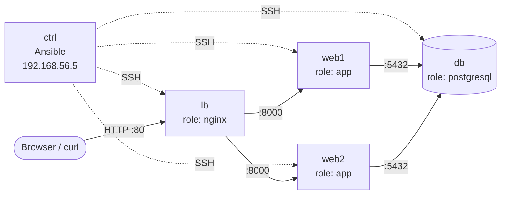

# Ansible three-tier lab

[](https://github.com/MrHamdiChedli/ansible-three-tier-lab/actions/workflows/lint.yml)

The web stack from [vagrant-three-tier-lab](https://github.com/MrHamdiChedli/vagrant-three-tier-lab), rebuilt with **Ansible**.
The Bash scripts are gone: a control node configures 4 plain Ubuntu servers over SSH with 4 roles.
Tests prove the stack works, survives a web server failure, and that **running Ansible again changes nothing**.



## What changed from the Bash version

| Bash version | Ansible version |
|--------------|-----------------|
| Each script checks by hand before changing anything | Modules are idempotent: they only report `changed` when they really change something |
| IP addresses copied into every script | Addresses come from one [inventory](ansible/inventory/hosts.ini); the database firewall, its access rules and the load balancer are all generated from it |
| Services restarted on every run | Handlers restart a service only when its configuration changed |
| An Nginx typo takes the load balancer down | The handler runs `nginx -t` first and only reloads if the configuration is valid |
| No checks on the code | Every push runs `ansible-lint` (production profile) and `shellcheck` |

**Adding a web server:** add one line to the inventory (and one VM to the Vagrantfile). The database, the firewalls and the load balancer pick it up on the next run.

## Run it

You need [VirtualBox](https://www.virtualbox.org/), [Vagrant](https://www.vagrantup.com/) and about 4 GB of free RAM.
Nothing to install on your machine: Ansible runs inside the `ctrl` VM.

```bash
vagrant up                       # about 10 minutes the first time
bash tests/smoke-test.sh         # the stack works and survives losing web1
bash tests/idempotence-test.sh   # a second run reports changed=0 everywhere
```

Expected output of the idempotence test:

```
db    : ok=13   changed=0    unreachable=0    failed=0 ...
lb    : ok=11   changed=0    unreachable=0    failed=0 ...
web1  : ok=14   changed=0    unreachable=0    failed=0 ...
web2  : ok=14   changed=0    unreachable=0    failed=0 ...
PASS: second run changed nothing
```

Run the playbook yourself from the control node:

```bash
vagrant ssh ctrl
cd /vagrant/ansible
DB_PASSWORD=$(cat ../.db_password) /opt/ansible/bin/ansible-playbook site.yml --check --diff
```

Clean up with `vagrant destroy -f`.

## Repository layout

```
Vagrantfile                 4 managed nodes + the ctrl node, defined last so it runs once the others exist
bootstrap/ctrl.sh           Installs Ansible in a virtualenv, hands it the node SSH keys, runs the playbook
ansible/
  ansible.cfg
  requirements.yml          Pinned collections: community.general, community.postgresql
  inventory/hosts.ini       Who is db, web and lb
  inventory/group_vars/     Addresses derived from the inventory, DB password read from the environment
  site.yml                  One play per tier
  roles/common/             Base packages, firewall that denies by default
  roles/postgresql/         PostgreSQL, pg_hba rules and firewall for the web servers only
  roles/app/                Virtualenv, systemd service, settings readable only by the app
  roles/nginx/              Load balancer generated from the web group, validated before reload
tests/                      Smoke/failover test and idempotence test
.github/workflows/lint.yml  ansible-lint and shellcheck on every push
```

## Problems hit while building it

- **A lost restart.** The first run failed halfway, so the handler that restarts PostgreSQL never ran. The next runs saw the config file already correct and didn't restart it either, so PostgreSQL kept listening on `127.0.0.1` only and the web servers got "database unreachable". Fix: `force_handlers = True` in [ansible.cfg](ansible/ansible.cfg), so pending handlers run even when a task fails.
- **`no_log` hides the error too.** The failing task protected the password, so the error message was censored. I reproduced it with an ad-hoc `ansible` command and a dummy password: the option is `no_password_changes`, not `update_password`.
- **Hosts and groups with the same name** (`db`, `lb`) made Ansible warn and could target the wrong thing. The groups are now `dbservers`, `webservers` and `loadbalancers`.

## Traps avoided by design

- **Ansible ignores `ansible.cfg` in a world-writable folder**, which is how VirtualBox mounts shared folders by default. The control node mounts it with `dmode=755,fmode=644`.
- **SSH refuses private keys that others can read.** The bootstrap copies each node key to `~/.ssh` with mode `600`.
- **`become_user: postgres` needs the `acl` package** for Ansible's temporary files, so the `common` role installs it everywhere.
- **No secret in Git or in logs**: the password is read from the environment, and the tasks that use it have `no_log: true`.
